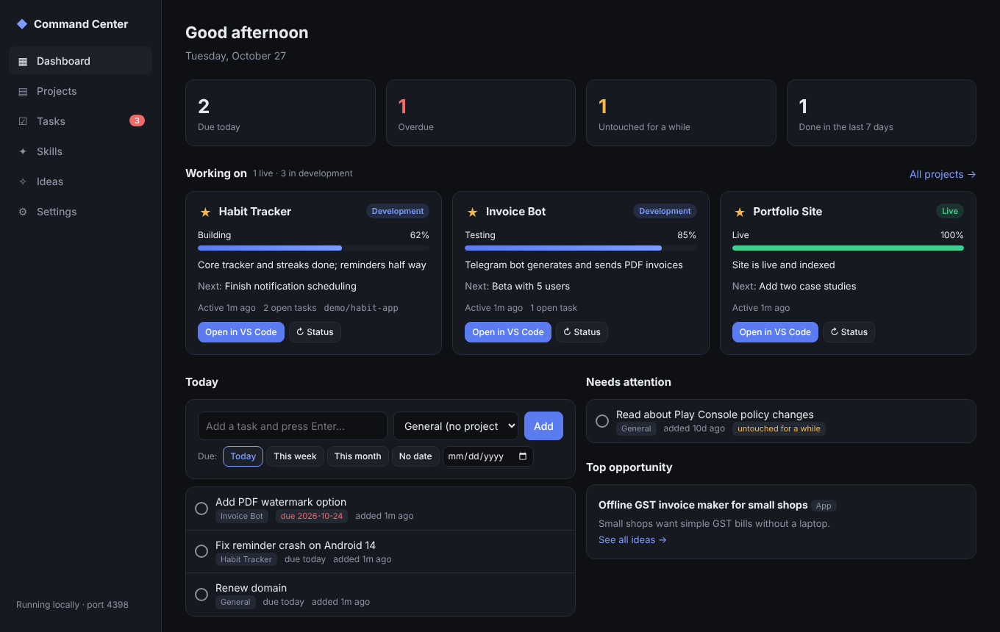
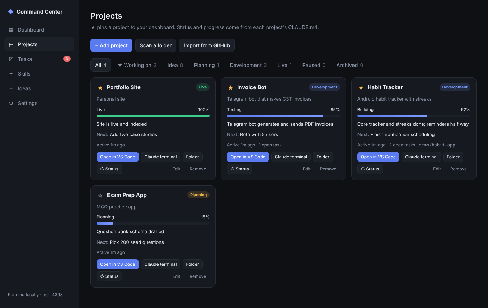
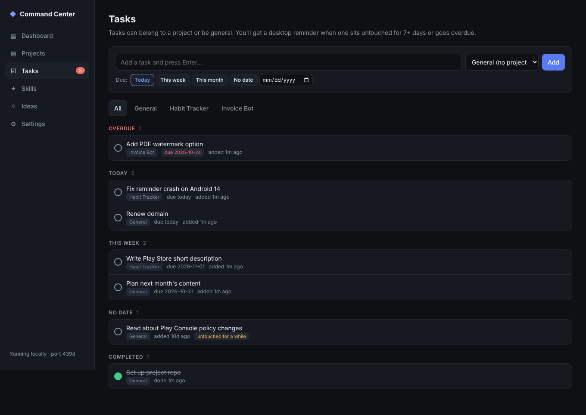
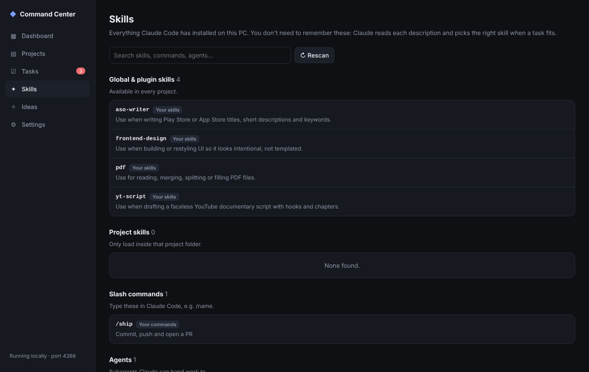
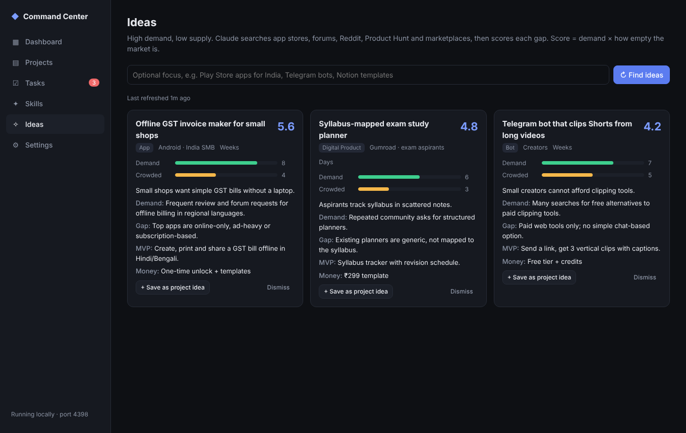

# Command Center

A local dashboard for your projects, tasks, Claude Code skills and new ideas. It runs on your PC at http://localhost:4321 and only listens on your own machine.



| Projects | Tasks |
|---|---|
|  |  |
| **Skills** | **Ideas** |
|  |  |

*Screenshots use sample data.*

## Setup (Windows, about 5 minutes)

1. **Install Node.js LTS** from nodejs.org if `node -v` doesn't work in a terminal.
2. **Unzip** this folder somewhere permanent, e.g. `C:\Users\you\command-center`.
3. **Double-click `start.bat`.** The first run installs dependencies, then the dashboard opens in your browser.
4. **Make "Open in VS Code" work:** in VS Code press `Ctrl+Shift+P` → *Shell Command: Install 'code' command in PATH* (on most Windows installs `code` already works).
5. **Run in the background at login (recommended, so reminders fire):** double-click `install-startup.bat` once. `uninstall-startup.bat` undoes it.

## First things to do in the app

1. **Projects → Scan a folder.** Point it at the folder that holds your projects; it finds every project (git repo, CLAUDE.md, package.json, Gradle, Flutter, Python and so on) two levels deep.
2. **Star (★)** the projects you're actively working on. Only starred ones show on the Dashboard. Set each one's status: Idea, Planning, Development, Live, Paused, Archived.
3. **Settings → Connect to Claude Code.** This is the piece that makes everything automatic (details below).
4. **Settings → GitHub token** (optional). Create a fine-grained token with read-only access; then use **Projects → Import from GitHub** and see issues and last push on each card.
5. On each project card, press **+ Status block** (adds one to its CLAUDE.md), then **↻ Status** once to have Claude fill it in.

## How the automation works

**Context per project.** Each project's `CLAUDE.md` gets a small status block:

```
<!-- status:start -->
## Status
- Phase: Building
- Progress: 60%
- Summary: Launcher and contacts done; widgets in progress
- Next: Finish SOS widget
- Blockers: none
- Updated: 2026-10-27
<!-- status:end -->
```

The dashboard reads that block for each project's progress bar. If a project has no block, it falls back to the `- [x]` / `- [ ]` checklist in CLAUDE.md.

**Keeping it updated without thinking about it.** "Connect to Claude Code" adds a marked block to your global `~/.claude/CLAUDE.md` (it backs the file up first). Every Claude Code chat in every project then:

- loads `~/.claude/projects-index.md`, an auto-generated list of all your projects, so Claude knows what else you're building;
- updates the project's status block whenever meaningful work is finished;
- uses your installed skills whenever a task matches, without you naming them.

You can also press **↻ Status** on any card: it runs `claude -p` in that folder to re-read the project and rewrite only the status block.

**Skills.** The Skills page lists everything installed: your skills (`~/.claude/skills`), plugin skills, project skills, slash commands and agents, with search. Claude Code already picks skills automatically from their descriptions, so this page is for your reference.

**Tasks.** Quick-add with Today / This week / This month / No date / any date, with or without a project. Reminders: a Windows notification when a task is overdue or untouched for N days (7 by default; change it in Settings). Each task nags at most once a day; **Snooze** quiets it for 3 days. Clicking the notification opens the Tasks page.

**Ideas.** Press **Find ideas** (optionally with a focus like "Play Store apps for India"). It runs Claude Code headless with web search to look for high-demand, low-supply gaps across app stores, forums, Reddit, Product Hunt, Gumroad and bot/extension markets, and scores each one. It uses your Claude plan, not an API key, and takes a few minutes. **Save as project idea** files a good one under Projects → Idea.

## Requirements for the Claude-powered buttons

↻ Status and Find ideas need the Claude Code CLI: typing `claude` in a terminal should start it, and you should have signed in there once. The VS Code extension alone isn't enough for these two buttons; everything else works without the CLI.

## Your data

Everything lives in `data/db.json` in this folder. Back it up or put the folder in a private repo (`data/` is gitignored by default; remove that line if you want it versioned).

## Changing the port

Set the `PORT` environment variable before starting (default 4321).
